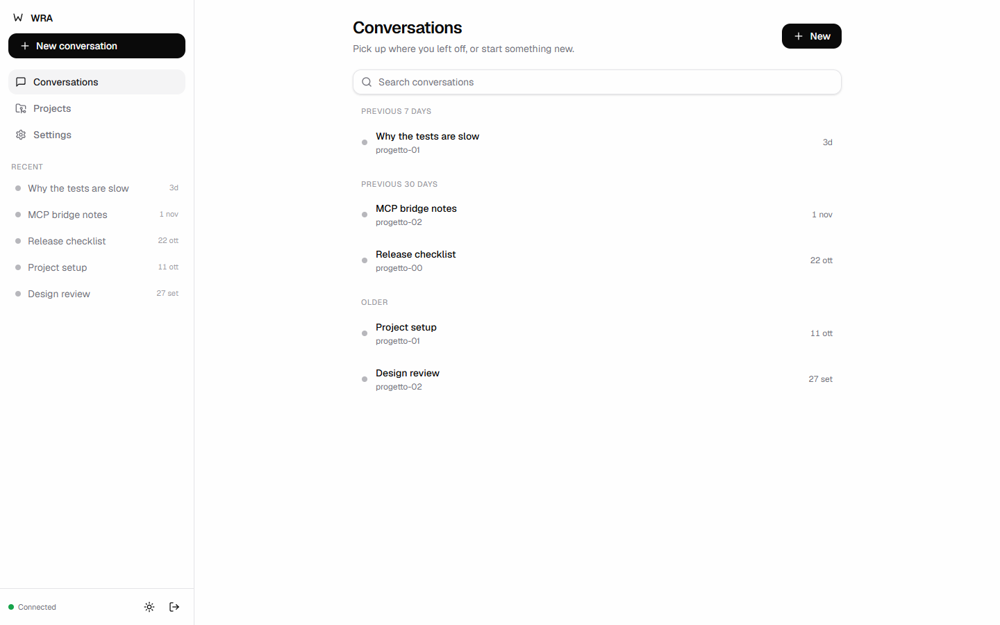
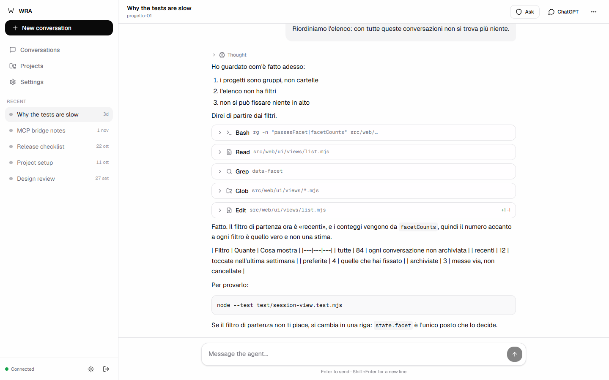
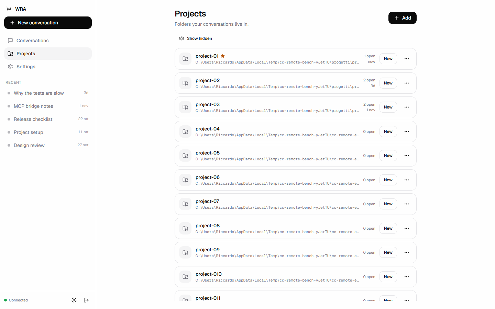
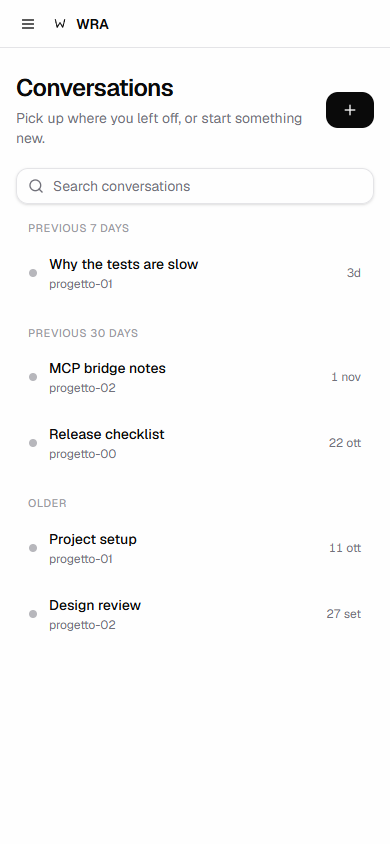

# WRA

**Workspace Relay for Agents.** Control the real **Claude Code** running on your own machine — from
a terminal, a browser, a phone, or ChatGPT.

WRA does not reimplement an agent and does not patch somebody else's terminal wrapper. It runs the
genuine `claude` TUI inside a PTY, keeps one process per conversation, and puts four things around
it:

- a **web interface** (chat view, real terminal, permission approvals) that works on a phone;
- a **session registry** on disk, where a conversation keeps its identity across restarts;
- an **MCP bridge** so ChatGPT can list, pick and talk to the conversations you explicitly allow;
- an **approval relay**: when a tool asks for permission, the request appears in your browser and
  the answer goes back to the agent — never granting anything on its own, except by the
  **controlled automatic mode** you switch on per conversation (or per project): file edits
  *inside* that project stop asking, while commands, paths outside it and credentials keep asking.
  Off by default, revocable at the next request. See
  [docs/SECURITY.md](docs/SECURITY.md#controlled-automatic-mode-mcp-automatico-controllato).

It is deliberately small: Node.js, one dependency for the PTY, the official MCP SDK. The React
frontend in `web/` is built once into `web/dist`; the classic UI in `src/web/` has no build step.

## WRA — Workspace Relay for Agents

**This project was previously called `cc-remote`.** It is now **WRA**, Workspace Relay for Agents.
The primary command is `wra`; `rc` and `cc` still work as aliases, so existing scripts and muscle
memory keep working. State directories (`~/.cc-remote`, `.cc-remote`), `CR_*` environment variables,
the `x-cc-remote-token` header, the Cloudflare domain and the MCP endpoint URLs are unchanged in
this phase — they are kept as they are for compatibility.

The normal gestures:

```bash
wra new                  # open a NEW conversation in this folder
wra -c                   # resume the most recent conversation of this folder
wra                      # open the workspace (start the server if needed, then the interface)
```

`cc`, `cc -c` and `rc …` remain valid aliases for backward compatibility.

## Requirements

- **Windows 10/11** is the supported platform (tested on Windows 11 x64, PowerShell 5.1/7).
  **Node.js 24+** is required. macOS and Linux are not supported in 1.0: the server may run, but
  the installer, autostart and the supported workflows are Windows-only and untested elsewhere.
- **Claude Code** installed and working on that machine (`claude --version`). Whatever
  authentication you already use — an API key, `apiKeyHelper`, a gateway like OpenRouter — keeps
  working, because the child process inherits your environment unchanged.
- For browser/phone access from outside your machine: any HTTPS front (Tailscale Serve,
  Cloudflare Tunnel, Caddy). WRA never opens a port to the internet by itself.

## Install

### Windows installer (recommended)

```powershell
installer\Install-WRA.ps1 -PackagePath installer\dist\wra-1.0.0.tgz
```

No administrator rights. Installer into `%LOCALAPPDATA%\WRA`, puts `wra`/`rc`/`cc` on the user
PATH, keeps state in `%USERPROFILE%\.cc-remote`, optionally starts at logon, and opens the guided
onboarding. It detects Node.js 24+ and Claude Code and tells you what is missing instead of
installing it. Build the versioned tarball with `installer\build-package.ps1`. Uninstall with
`installer\Uninstall-WRA.ps1` (conversations kept unless you pass `-PurgeState`). Details and
limitations: [installer/README.md](installer/README.md).

### From source

```bash
git clone <this repo> wra
cd wra
npm ci
npm link                         # puts `wra` on your PATH (optional: everything works as `node src/cli/index.mjs …`)
wra start                        # prints the address and where the token is
```

The first run creates a 192-bit token in `~/.cc-remote/token`. The server binds `127.0.0.1` only.

### Install as a package, and update

```bash
npm pack                                # wra-<version>.tgz
npm install -g ./wra-<version>.tgz      # `wra` on the PATH, no clone
wra --version                           # the version is read from package.json, there is only one
```

To update, install the newer tarball over the old one. **Nothing of yours lives in the package**:
the registry, the token, the backups and the settings are in `~/.cc-remote/`, and the transcripts
are in `~/.claude/projects/` — so an update never touches a conversation. `wra autostart` keeps
pointing at the same paths, so a new version is picked up at the next logon (or at the next
`wra start`).

`node tools/pack-check.mjs` proves the packaged copy is complete: it packs, installs into a
throwaway folder, boots the installed copy, and asks every URL `index.html` references, then opens
it in a real browser. It exists because a packaged install once served `/vendor/xterm/css/xterm.css`
as 404 — the terminal opened without its stylesheet, which is a defect you only see after
installing, when it costs the most.

## Use

```bash
wra                      # open the workspace: start if needed, then open the interface
wra start                # start in the background (never starts a second one)
wra status               # what is running, which conversations exist
wra doctor               # full diagnostic: registry, backup, journal, claude, bridge, turns
wra web                  # open the interface in your browser
wra stop                 # controlled shutdown (conversations are kept)

wra new                  # open a NEW conversation in this folder, attached to this window
wra -c                   # resume the most recent conversation of this folder
```

`wra new` starts the server if it is not running, so there is no step before it. Ctrl+Q detaches:
the conversation keeps running on the server. `Ctrl+]` does the same, and `wra detach` needs no key
at all.

`wra new` creates the conversation with the server's default permission mode and attaches this
window to it. The `cc` alias does the same but requests **permissions bypassed** — the agent acts
without asking, which is what you want when you are sitting at this machine. Bypass is a property
of that conversation, not of the server: a `wra -c` resume keeps the mode the conversation already
had, and a bypass conversation cannot be exposed to ChatGPT. Turn it off with
`wra permissions default`, or from the ⋯ menu in the interface; the sidebar shows a `bypass` chip.
Without a TTY, `wra new` only creates the conversation and prints how to attach.

Other commands:

```bash
wra access               # how to reach this from outside: Tailscale or Cloudflare Tunnel
wra attach [id|name]     # attach this window to a conversation (--view for read-only)
wra detach [id|name]     # detach the attached windows: no key needed, conversations stay alive
wra permissions [mode]   # show or change a conversation's permission mode (default | bypassPermissions | …)
wra sessions             # list conversations with state and MCP authorisation
wra talk                 # send a turn to the selected conversation and print the reply
wra migrate              # conversations already on disk, to bring into the registry
wra backup               # safety copy of the state; also --list, --verify, restore
wra restart              # stop and start again (settings and restores are read at startup)
wra admin                # where the admin panel is, and what it says right now
```

## The admin panel

Everything the terminal commands do, from the interface, so you do not have to know them. Open it
from the button at the bottom of the sidebar, or go straight to `/#impostazioni`.

| Section | What it does |
|---|---|
| **Status** | Server and project version, conversations by state, the processes the server is really running (with their PIDs), MCP bridge, connected windows, diagnostic checks, where every file lives, recent log, restart |
| **Access** | The three ways in — local only, Tailscale, Cloudflare Tunnel, or two of them together — with the exact commands to run, applied only on your confirmation. Then a **verification** that says what it asked and what came back: Cloudflare Access in front of the dashboard, the token gate, APIs answering 401 without a token, and `/mcp` answering from the bridge rather than with a login page. If neither protection is in front, it says so instead of pretending |
| **Backups** | Create, list, verify by checksum, preview a restore (which conversations come back, which leave), restore with confirmation — the current state is put aside first, and the registry is reloaded without a restart. Transcripts are never touched |
| **Settings** | Default project folder and allowed roots (the folders an agent may run in). Validated: network paths, symlinks and missing folders are refused. Applies at the next startup, and it says so |

The panel is one application: on a phone it is a single column with thumb-sized targets, and it
never shows a token, a secret, or a state it has not verified.

**First run.** With an empty registry the Status section becomes a checklist — Claude Code found,
registry readable, project folder chosen, a backup made, remote access decided (optional) — and
each line is fixed from the page itself. Nothing is exposed before it is protected.

## The interface

The React frontend in `web/` is the **default** UI: build it and the server serves it whenever
`web/dist` exists. The classic interface in `src/web/` remains the rollback path, selected with
`CR_REMOTE_UI=classic`.

```bash
cd web && npm install && npm run build
wra serve
# rollback: CR_REMOTE_UI=classic wra serve
```

Three destinations (Conversations, Projects, Settings), conversations as persistent objects that
resume on open, a compact per-conversation permissions control, and a one-dialog ChatGPT
connection. See [docs/FRONTEND-2.md](docs/FRONTEND-2.md).

### The classic interface (fallback)


- **Chat view**: turns with the agent's text, its reasoning (collapsible, with the duration the
  transcript records), tool cards with their outcome, real diffs for file edits, and errors that
  open themselves.
- **Terminal view**: the original TUI, untouched. Switching tabs does not lose the chat.
- **Approvals**: the exact command, and a red card when it looks destructive.
- **Sidebar**: projects that expand and collapse, filters with counts (all, recent, favourites,
  active, archived), search, and a per-project menu. Conversations can be pinned to the top, put
  in a *section* (a label — the folder never moves), archived, renamed. The sidebar is resizable
  and remembers how you left it; a project can be renamed, starred or set aside without touching
  the folder or a single transcript.
- Search **inside** the messages, bounded and honest about what it did not reach.
- **Home**: with no conversation open, what is running now, what you used recently, and your
  projects. The address bar keeps the open conversation (`#c=…`), so a refresh comes back to it.
- **Bulk actions**: pick several conversations (a row, or a whole project) and archive, pin or
  move them into a section together — the panel says how many before you press.
- Light and dark themes, installable as a PWA, works on a phone.

Details, tokens and accessibility notes: [docs/UI.md](docs/UI.md).

## Screenshots

Demo data, isolated test server.









## How it fits together

```
        browser / phone                ChatGPT
              │  HTTPS                   │  HTTPS (public)
              ▼                          ▼
        Tailscale Serve            Cloudflare + Access
              │                          │
              └────────► WRA (127.0.0.1:4310) ◄────────┘
                              │
                    session registry (one process per conversation)
                              │
                          claude (real TUI, in a PTY)
```

Two access paths, kept separate on purpose: the browser goes through your private network (or
through Cloudflare Access on your own domain), the MCP bridge needs a public HTTPS endpoint that
only exposes the OAuth and MCP routes. The code keeps the two surfaces apart — on the dashboard
hostname the machine routes answer 404, and on the MCP hostname the dashboard does.

Two official ways to get in from outside, either or both: **Tailscale** (private tailnet, no
domain needed) and **Cloudflare Tunnel** (your own domain, behind Cloudflare Access, mandatory for
the admin dashboard). `wra access` writes the choice and prints the commands to run; it never
changes your tunnel or DNS by itself. See [docs/REMOTE-ACCESS.md](docs/REMOTE-ACCESS.md) and
[docs/CHATGPT.md](docs/CHATGPT.md).

Architecture and the reasoning behind it: [docs/DESIGN.md](docs/DESIGN.md).

## Documentation

| Document | What is in it |
|---|---|
| [docs/CLI.md](docs/CLI.md) | every command, exit codes, non-interactive use, environment |
| [docs/TROUBLESHOOTING.md](docs/TROUBLESHOOTING.md) | what to check when something does not work |
| [docs/ENGINES.md](docs/ENGINES.md) | how a second agent engine would be added |
| [docs/security/CLOUDFLARE-ACCESS-REVIEW.md](docs/security/CLOUDFLARE-ACCESS-REVIEW.md) | the five Access findings: path matrix, verification, residual risk |
| [RELEASE-NOTES.md](RELEASE-NOTES.md) | what 1.0 changes, compatibility, known limits |
| [CONTRIBUTING.md](CONTRIBUTING.md) | setup, tests, conventions, security reports |
| [installer/README.md](installer/README.md) | Windows installer: build, install, update, uninstall, limits |
| [docs/OPERATIONS.md](docs/OPERATIONS.md) | service model, recovery, release gate |
| [docs/RELEASE.md](docs/RELEASE.md) | publishing on GitHub: what is verified, what to decide first |
| [docs/DESIGN.md](docs/DESIGN.md) | how it is built and why |
| [docs/SECURITY.md](docs/SECURITY.md) | threat model, what protects what, known limits |
| [docs/WINDOWS.md](docs/WINDOWS.md) | Windows setup, shortcuts, startup |
| [docs/MIGRATION.md](docs/MIGRATION.md) | moving from claude-remote/cloudcli, and rolling back |
| [docs/BACKUP.md](docs/BACKUP.md) | backup, verification, restore |
| [docs/CHATGPT.md](docs/CHATGPT.md) | connecting ChatGPT as an MCP client |
| [docs/REMOTE-ACCESS.md](docs/REMOTE-ACCESS.md) | reaching the dashboard from outside: Tailscale, Cloudflare Tunnel, or both |
| [docs/UI.md](docs/UI.md) | the interface: tokens, components, accessibility |
| [docs/FRONTEND-2.md](docs/FRONTEND-2.md) | the React frontend, now the default |
| [CHANGELOG.md](CHANGELOG.md) | what changed, and when |

## Tests

```bash
node --test                       # the whole suite
node tools/check-contrast.mjs     # WCAG contrast of both themes
node tools/smoke-remote.mjs <url> # the outside path, over real HTTPS
node tools/smoke-oauth.mjs <url>  # the whole OAuth flow, over real HTTPS
node tools/smoke-resume.mjs       # restart and resume, with the real Claude Code
node tools/smoke-crash.mjs        # the agent dies mid-turn, with the real Claude Code

# the interface in a real browser: real mouse clicks, so it notices what is *on top* of a button.
# Each bench builds its own throwaway world (registry, server, fake TUI) and cleans it up after.
node tools/ui-check.mjs             # 35 checks on the interface
node tools/ui-admin-check.mjs       # 14 checks on the admin panel
node tools/bench-rounds.mjs 10      # ten rounds of both, to prove they repeat
node tools/ui-perf.mjs              # 10/100/500/2000 conversations, timed
```

## Licence

MIT — see [LICENSE](LICENSE).